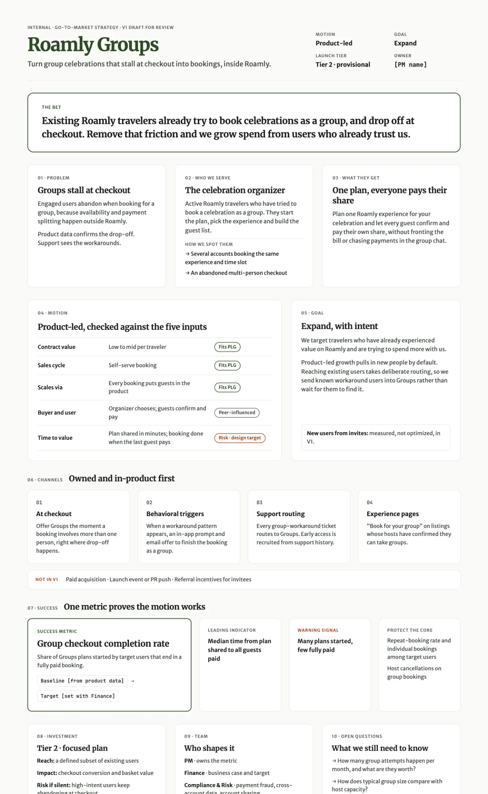

# GTM Strategy · Roamly Groups

> Module 1 · Deliverable 1. Completed from the Module 1 Lab Guide.

## 1. Discover Framework

### Align on the Goal
- **Core business problem:** Roamly customer support has discovered that highly engaged users are dropping off right at checkout. The pattern centers on friction points in group activity planning: users resort to workarounds for sharing availability and splitting payments outside the core app. At the same time, users say they wish they could do this within Roamly.
- **What success looks like:** Roamly delivers a cohesive experience for planning a group travel experience, confirming availability/attendance, and splitting/processing individual payments, all within its core app. This would improve the checkout rate and likely increase the value of each basket. Group leaders would act as brand champions, introducing invitees to the Roamly community. As a highly contentious flow and a requested feature, this would also relieve work that customer support currently has to do.

### Do the Research
- **Signals of a real opportunity:**
  - Customer support has direct reports of account hacking and workarounds
  - Group bookings are being solved by dedicated accounts
  - Split payment and availability syncing point to real problems to solve
  - The drop-off in conversion is backed by product data
- **Top 5 possible segments:**
  1. Solo travelers looking to meet or join a group
  2. University students looking for group deals to explore different destinations
  3. Families looking for a complete solution for a vacation
  4. Large groups of friends travelling for special celebrations
  5. Clubs or social communities looking to plan trips together
- **How to size the opportunity:**
  - First-party data: count of group bookings per month and the lost-conversion ratio; basket size investigation (successful vs. lost group bookings); group size; group make-up demographics for more detailed use cases across the five segments
  - Market research: define the TAM for group travel
  - Competitive research: define direct and adjacent competitors, e.g. Airbnb (group experience) and Splitwise (feature-specific)

### Build a Working Team
- **Cross-functional stakeholders:**
  - Finance: business case for change, sharpen the financial goal
  - Compliance & Risk: information sharing across accounts and privacy policies, fraud prevention in increased payment flows
  - Marketing: in-product and lifecycle messaging
  - Host / Community: share insights into group pain points and expectations
  - Customer Support: shed light on workarounds not captured in product data
  - Analytics: sizing and behavioral triggers

### Form Your Hypothesis
- **Most valuable segment to target first, and why:** The primary segment is the weary group leader for special celebrations: the person motivated to initiate the plan, determine the initial invitee list, and crystallize the group chat plan into a Roamly Groups booking. This is the user who will experience the first aha moment and determine whether we have removed the friction points enough to continue. Winning these users over first will convert them into repeat ambassadors, potentially reaching different users and groups in future bookings. The network effect of their success will add to the virality of the product.
- **Core value proposition:** A smooth, unified group booking experience where an individual can share a plan, and invitees can confirm availability/attendance and pay individually. All layered on top of the amazing curated local experiences, hosted by vetted local experts, that users have come to expect.

## 2. GTM motion
- **Chosen motion:** Product-led growth (PLG)
- **Why:** I chose to focus on a PLG strategy because the signals are clear and the community is vibrant. The demand is there and ready to scale by just adding solutions that can demonstrate value in minutes.

## 3. Primary goal
Expand

## 4. The assumption I'm pushing back on
I'm pushing back on the assumption that "the invitee, not the organizer, decides whether this works" and that we should focus on acquisition rather than expansion.

The segment gap was identified by support solving problems for existing users. This suggests we are helping individuals who have already had an aha moment increase their spend via group bookings. The only blocker is the product. We don't know whether the invitees are non-users. Acquiring new users is a bonus we are not optimizing for yet. Focusing on expansion will require finding a way to nudge users with known workarounds to use Roamly Groups.

## 5. V1 GTM strategy one-pager

### Roamly Groups · V1 GTM strategy (draft)

**The bet.** Existing Roamly travelers already try to book celebrations as a group and abandon at checkout. Removing that friction grows spend from users who already trust us.

**Problem.** Engaged users drop off at checkout when booking for a group, because coordinating availability and splitting payment happen outside Roamly. Product data confirms the drop-off, and support sees the workarounds directly.

**Target segment.** Active Roamly travelers who have tried to book a celebration (birthday, bachelor/ette, reunion) as a group. Two behaviors identify them: several accounts booking the same experience and time slot, or an abandoned multi-person checkout. We serve the organizer: the person who starts the plan, picks the experience, and builds the guest list.

**Value proposition.** Plan one Roamly experience for your celebration and let every guest confirm and pay their own share, without fronting the bill or chasing payments in the group chat.

**Motion: product-led (PLG).**
- Purchase is self-serve, and the value per traveler is low to mid.
- The product spreads naturally, because every booking exposes guests to Roamly.
- The risk is time to value. The organizer can share a plan in minutes, but the booking isn't complete until the last guest pays. Closing that gap is the main design target.

**Goal: Expand.** The course rates product-led plus Expand as "requires intent." We meet that by actively routing known workaround users into Groups instead of waiting for them to discover it. New users who arrive through invites are measured but not optimized for in V1.

**Channel approach (owned and in-product first):**
1. **At checkout,** where people drop off: offer Groups as soon as a booking involves more than one person.
2. **Behavioral triggers:** when the workaround patterns appear (shared time slot across accounts, abandoned group checkout), send an in-app prompt and email offering to finish the booking as a group.
3. **Support as a channel:** route every group-workaround ticket to Groups, and recruit the early-access cohort from support history.
4. **Experience pages:** add "Book for your group" to listings whose hosts have confirmed they can take groups.

**Not in V1:** paid acquisition, a launch event or PR push, or referral incentives for invitees.

**Success metric: group checkout completion rate.** The share of Groups plans started by target users that end in a fully paid booking.
- Baseline: current group-session conversion [from product data]
- Target: [set with Finance]
- Leading indicator: median time from plan shared to all guests paid
- Warning signal: many plans started, few fully paid
- Protect the core: repeat-booking rate and individual bookings among target users, plus host cancellations on group bookings

**Investment tier (provisional): Tier 2, focused GTM plan.**
- Reach: a defined subset of existing users
- Impact: checkout conversion and basket value
- Risk if we say nothing: high-intent users keep abandoning at checkout

Re-score once the sizing data is in.

**Team**
- PM, who owns the metric: Guillermo O'Byrne
- Finance: business case and target
- Compliance & Risk: payment fraud, cross-account data sharing, account sharing
- Marketing: in-product and lifecycle messaging
- Host/Community: group capacity and expectations
- Customer Support: the workaround cohort
- Analytics: sizing and behavioral triggers

**Open questions**
1. How many group attempts happen per month, and what are they worth?
2. How does typical group size compare with host capacity?
3. What share of invitees are already Roamly users?
